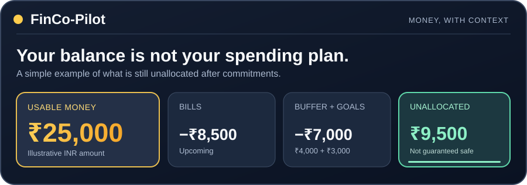

# FinCo-Pilot

**Your money, with context.**

Accounts · Transactions · Budgets · Savings goals · Upcoming bills

 

[**Explore FinCo-Pilot**](https://fincopilot.app/welcome/) &nbsp;·&nbsp; [See features](https://fincopilot.app/welcome/features/) &nbsp;·&nbsp; [Try the free calculator](https://fincopilot.app/welcome/tools/safe-to-spend/)

 

Illustrative numbers only. No connected account or personal financial recommendation.

---

## Your bank balance is only the beginning

Having money in an account does not mean all of it is available for new spending. Rent, EMIs, subscriptions, card payments and savings commitments may already have a purpose.

FinCo-Pilot is a personal finance workspace for bringing **accounts, expenses, budgets, goals and reports** into the same picture. Start with manual records; a bank connection is not required to begin.

> **The useful question:** After obligations and reserves, how much money is *still unallocated*?

### See the idea in 30 seconds

Imagine you have **₹25,000** that you can actually use during a defined planning period:

| Set aside for | Example |
| :-- | --: |
| Usable starting money | ₹25,000 |
| Upcoming bills and commitments | −₹8,500 |
| Emergency buffer | −₹4,000 |
| Savings goal reserve | −₹3,000 |
| **Not yet allocated** | **₹9,500** |

That **₹9,500 is not a promise that it is safe to spend**. It is the remainder of a simplified example. Pending payments, other debts, uncertain income and missing transactions can change the real answer. If commitments exceed usable money, the difference is a shortfall, not extra spending power.

[**Try this with your own numbers — free INR calculator**](https://fincopilot.app/welcome/tools/safe-to-spend/)

The public example operates without connecting to a bank account. Review the calculator's assumptions before interpreting a result.

---

## What can you do with FinCo-Pilot?

**Organize.** Bring manually recorded cash, bank and card accounts together. Review transaction amounts, dates, categories and the accounts they belong to.

**Plan.** Keep budgets, savings goals, recurring bills and EMI commitments in view when considering the next money decision.

**Review.** Preview supported transaction files before import. Check column mappings, dates, debit and credit signs, currencies and possible duplicates. Explore reporting and other modules where available.

The actual app features, supported providers and plan limits depend on your configuration and eligibility. FinCo-Pilot does **not** claim universal bank or UPI synchronization.

[Explore the documented features](https://fincopilot.app/welcome/features/) · [Read the first-session walkthrough](https://fincopilot.app/welcome/how-it-works/)

## Start with one useful habit

You do not need to organize every transaction today. Try a short weekly review:

1. **Verify** the balances you can actually use. Do not invent missing opening balances.
2. **Record** spending and income for the same time period.
3. **Separate** transfers between your own accounts from genuine expenses.
4. **Look ahead** at bills, debt payments and the buffer you want to protect.
5. **Review** one budget category and one savings goal; adjust only after checking the records.

**Practical guides:** [10-minute weekly money review](guides/weekly-money-review.md) · [7-day money check in Hindi / हिंदी](guides/weekly-money-review-hi.md)

### Two common mistakes

**Counting the same UPI payment twice.** A payment might appear in a bank statement, wallet export and manually entered record. Match the underlying movement before counting it more than once. [Learn the review method](https://fincopilot.app/welcome/guides/track-upi-expenses/).

**Assuming an imported statement proves today's balance.** An import can omit the opening balance, earlier activity or pending payments. Preview the rows, inspect signs and reconcile with a reliable source. [Read the transaction-import checklist](https://fincopilot.app/welcome/guides/import-transactions/).

---

## Questions people often ask

<strong>Can I budget without connecting a bank account?</strong>

Yes. FinCo-Pilot documents a manual-first workflow. You can organize account records and build a budget without bank synchronization. Begin with verified balances and a few transactions. [Read the manual budgeting guide](https://fincopilot.app/welcome/guides/budget-without-bank-connection/).

<strong>How can I save more money each month?</strong>

Start by reviewing essential expenses and irregular bills before choosing a realistic savings amount. Categorize actual spending, identify subscriptions or costs you can reduce, and reserve money for near-term commitments. A goal can help track your intention, but neither an app nor this guide guarantees savings.

<strong>Does FinCo-Pilot automatically read UPI payments or support every bank?</strong>

No universal coverage is promised. Manual entry and file-review workflows are documented. Optional bank connections depend on providers, configuration, permissions, region and plan. Check the [live feature overview](https://fincopilot.app/welcome/features/) for current boundaries.

<strong>Is the calculator a verified safe-to-spend recommendation?</strong>

No. It is an educational calculation based on the amounts entered. It does not independently verify bank funds or predict every future expense. It is not personalized financial advice.

<strong>Is this the application's source-code repository?</strong>

No. This is the official public information and educational resource for FinCo-Pilot. The application source code, internal configuration and customer records are not distributed here.

---

## Learn more, from official sources

- **[FinCo-Pilot website](https://fincopilot.app/welcome/)** — understand the product and explore access.
- **[Features and availability](https://fincopilot.app/welcome/features/)** — documented workflows and limitations.
- **[About and editorial standards](https://fincopilot.app/welcome/about/)** — who maintains the public materials.
- **[Privacy](https://fincopilot.app/privacy) · [Terms](https://fincopilot.app/terms) · [Support](https://fincopilot.app/support)** — important before entering real information.

Privacy note: Never publish bank statements, payment references, credentials or account data in public GitHub issues. This repository is not a support inbox for private finance records.

---

FinCo-Pilot public information repository · Educational content, not financial advice · Synthetic examples only · Content reviewed 11 November 2026

